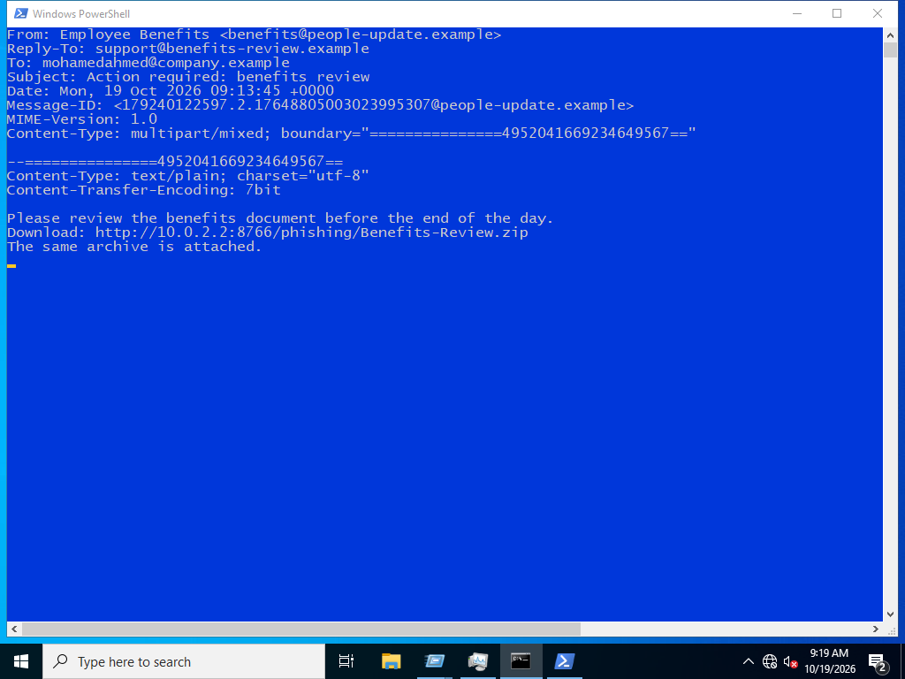
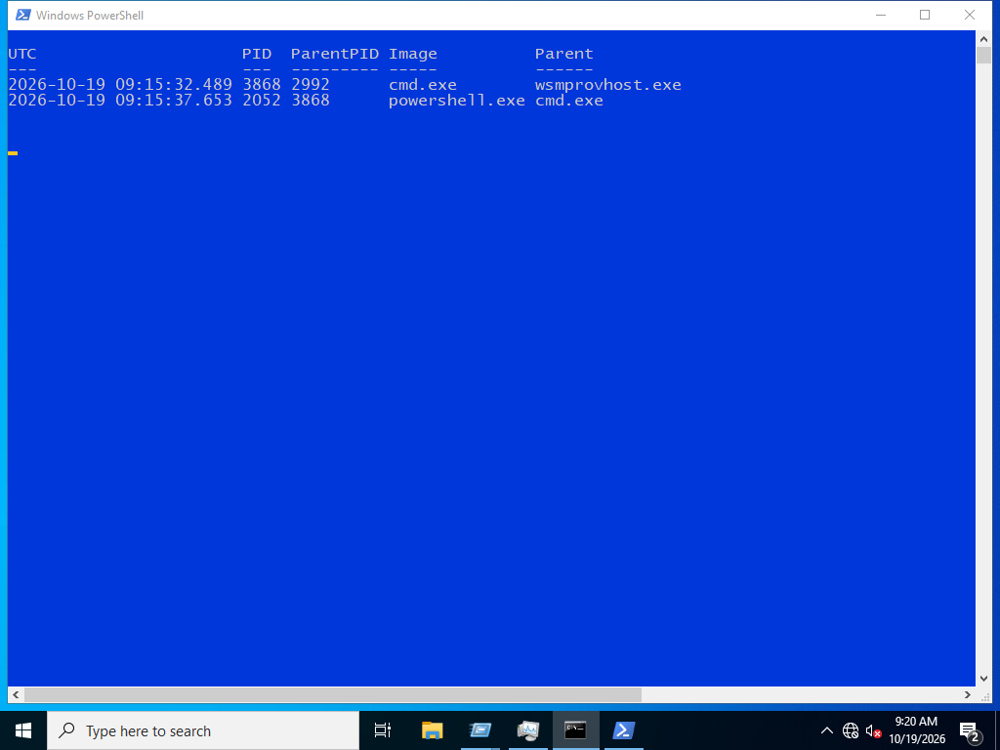

# Phishing to Endpoint Investigation

Tracing a controlled phishing delivery from the received email to Windows execution. The lab preserves the original EML messages, the delivered archive, its downloaded hash, native endpoint events and the related Splunk results.

## The case

An employee-benefits message asks for a document review before the end of the day. The same ZIP is attached and linked through the lab's internal HTTP service. Inside the archive, `Benefits-Review.pdf.cmd` is a command script whose name resembles a PDF.

Two SMTP deliveries were recorded. Execution was reproduced on **one endpoint**, `MOHAMEDAHMED`, using a safe payload that writes a local marker and makes an internal HTTP request. Delivery to the other mailbox is not evidence of execution there.

## Evidence chain

1. Preserve the original message bytes and Message-ID.
2. Extract and hash the archive from the received message.
3. Download the linked archive and compare the hash: `96df2ee248bcf001c06821f51341a3760da79ead873a609b0def34f1266550de`.
4. Inspect the real file extension, then trace `cmd.exe` to its PowerShell child.
5. Correlate the marker file and internal HTTP connection with the executing PID `2052`.

## Files

- [Investigation report](docs/investigation.md)
- [Build and reproduce](docs/reproduce.md)
- [Evidence index](evidence/README.md)
- [Original received email](evidence/mail/message-001.eml)
- [Delivered archive](evidence/Benefits-Review.zip)
- [Splunk process-chain export](evidence/search-results/02-process-chain.csv)

This is a local SMTP and Windows lab. It uses reserved example domains and a harmless payload; there is no credential collection, real malware or external command-and-control service.
