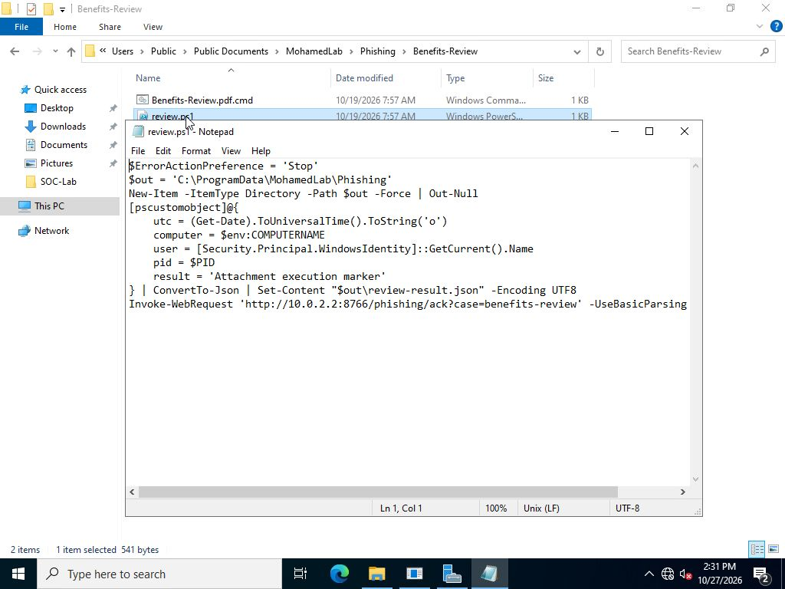
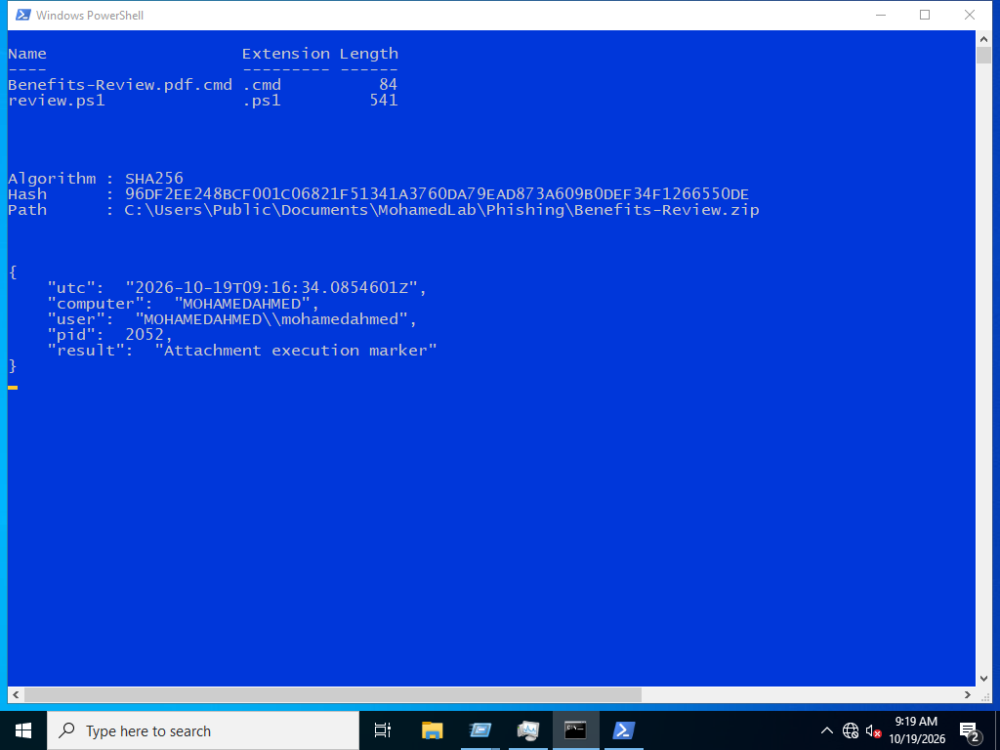
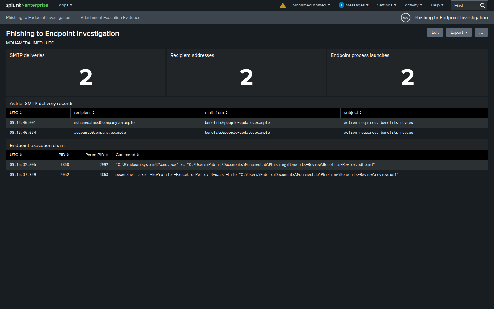

# Investigation report

## Environment

| Component | Configuration |
| --- | --- |
| Windows endpoint | `MOHAMEDAHMED`, Windows Server 2022 Evaluation |
| Local account | `MOHAMEDAHMED\mohamedahmed` |
| PowerShell | Windows PowerShell 5.1 |
| Endpoint telemetry | Sysmon process, network and file events; Security 4688; PowerShell 4104 |
| SIEM | Splunk Enterprise 9.4.1 on `MOHAMED-SIEM` |
| Service address | `10.0.2.2:8766`, reachable only inside the lab |

The Windows machine is standalone. The Linux VM hosts Splunk. All timestamps in the investigation are UTC.

## Collected evidence

The selected window is `2026-10-19T09:14:52.7729873Z` to `2026-10-19T09:17:00.9448236Z`. It contains **14 native Windows records**. The full selection is listed in [selection.json](../evidence/selection.json).

| Provider | Event ID | Records |
| --- | --- | ---: |
| Microsoft-Windows-PowerShell | 4104 | 2 |
| Microsoft-Windows-Sysmon | 11 | 6 |
| Microsoft-Windows-Sysmon | 3 | 2 |
| Microsoft-Windows-Security-Auditing | 4688 | 2 |
| Microsoft-Windows-Sysmon | 1 | 2 |

The normalized JSONL and original event XML identify the same channel/record-ID pairs. Event 4104 can be split into several parts; use its ScriptBlockId and part fields before interpreting long content. PID pivots are constrained to this host and time window, then checked against ProcessGuid.

## Message review

| Field | Recorded value |
| --- | --- |
| From | `Employee Benefits <benefits@people-update.example>` |
| Reply-To | `support@benefits-review.example` |
| Subject | Action required: benefits review |
| Attachment | `Benefits-Review.zip` |
| Linked archive | `http://10.0.2.2:8766/phishing/Benefits-Review.zip` |

| SMTP recipient | Message-ID |
| --- | --- |
| `mohamedahmed@company.example` | `<179240122597.2.17648805003023995307@people-update.example>` |
| `accounts@company.example` | `<179240122600.2.7455291422176946045@people-update.example>` |

The urgency, unfamiliar sender context, different Reply-To domain and misleading file name are investigation leads. A Reply-To difference alone does not prove maliciousness. This local SMTP setup does not perform SPF, DKIM or DMARC evaluation, so the lab makes no claim about authentication results or public domain reputation.

## Attachment and endpoint findings

The SHA256 calculated from the received MIME attachment matches the archive downloaded on Windows: `96df2ee248bcf001c06821f51341a3760da79ead873a609b0def34f1266550de`. The archive contains a `.cmd` launcher and `review.ps1`; a `.cmd` file is a command script, not a PDF or a PE executable.

The replay launches `cmd.exe`, which starts Windows PowerShell to run `review.ps1`. The marker records PID `2052`, computer `MOHAMEDAHMED`, account `MOHAMEDAHMED\mohamedahmed` and UTC `2026-10-19T09:16:34.0854601Z`. Its parent relationship and ProcessGuid are retained in the native Sysmon records and the [process-chain CSV](../evidence/search-results/02-process-chain.csv).

The archive is downloaded to the endpoint over the internal lab HTTP service. Endpoint replay begins with `cmd.exe`; its PowerShell child, marker write and HTTP request are linked through the recorded process identifiers.

## Scope and triage

The result is confirmed execution of the simulated phishing payload on MOHAMEDAHMED. The command-script launcher started PowerShell, which wrote the local result marker and contacted the internal lab service. The marker identifies account MOHAMEDAHMED\mohamedahmed and PID 2052; the native process, file and network records supply the execution evidence.

Two email deliveries and one endpoint execution were recorded. The other address has delivery evidence only. Search Message-ID, attachment hash and related sender/subject context to locate deliveries, then use endpoint and network evidence to establish user interaction and execution separately.

In a real incident, escalate an unexpected command-script-to-PowerShell chain with its message, hash, execution time, affected account and device. Capture what was delivered, what actually ran, and what remains unknown. Password resets or session revocation require evidence of credential exposure or the applicable response playbook; a delivered attachment alone does not establish it.

## File inspection

The [original EML viewed in Notepad](../images/windows-message-inspection.jpg) exposes the sender, Reply-To, Message-ID, body link and MIME attachment headers. Explorer and [file properties](../images/windows-attachment-properties.jpg) show the actual command-script extension.

Reading the script explains the local marker and internal HTTP request:

The archive hash was checked with `Get-FileHash`:

## Overview

